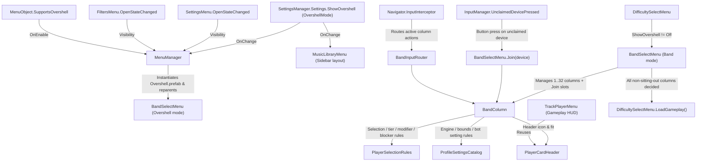

# Overshell & Band Select Architecture

The overshell feature introduces a persistent, per-player card strip (`BandSelectMenu` + `BandColumn`) that lets players join, configure profiles/settings, and ready up across menus or on the difficulty select screen.

---

## 1. Overshell Modes & Hosting

The feature is gated by `OvershellMode` in [SettingsManager.Settings.cs](file:///home/phil/Development/YARG/Assets/Script/Settings/SettingsManager.Settings.cs#L49-L54) and exposed via `MenuManager.UseOvershell` and `MenuManager.NeedsPlayers` ([MenuManager.cs](file:///home/phil/Development/YARG/Assets/Script/Menu/MenuManager.cs)):

- `Off` (default): Classic [DifficultySelectMenu.cs](file:///home/phil/Development/YARG/Assets/Script/Menu/DifficultySelect/DifficultySelectMenu.cs) runs; `MenuManager.NeedsPlayers` shows the no-player warning in `MusicLibraryMenu` when `PlayerContainer.Players.Count <= 0`.
- `DifficultySelect`: [DifficultySelectMenu.cs](file:///home/phil/Development/YARG/Assets/Script/Menu/DifficultySelect/DifficultySelectMenu.cs#L136-L147) hides the classic scroll list and opens its embedded `BandSelectMenu` (`_band`) in band mode. Earlier menus do not show the overshell, and `MenuManager.NeedsPlayers` stays `false` so players can enter a song and join on the band screen.
- `Everywhere`: `MenuManager.UseOvershell` is `true`, opening the overshell across supported menus in addition to band select.

### Single Overlay Hosting (`MenuManager`)

1. **Unified overshell overlay** ([MenuManager.cs](file:///home/phil/Development/YARG/Assets/Script/Menu/MenuManager.cs)): `MenuManager` lazily instantiates a single `_overshell` from `_overshellPrefab` ([Overshell.prefab](file:///home/phil/Development/YARG/Assets/Prefabs/Menu/DifficultySelect/Overshell.prefab)) and reparents it onto the active [MenuObject.cs](file:///home/phil/Development/YARG/Assets/Script/Menu/MenuObject.cs) whenever `MenuManager.UseOvershell` is `true`, `SupportsOvershell` is enabled (`MainMenu`, `MusicLibrary`, `Content`, `GameModes`), and the menu is active in hierarchy.
2. **Event-driven visibility & layout**: `MenuManager` reacts to `SettingsManager.Settings.ShowOvershell.OnChange`, `SettingsMenu.OpenStateChanged`, `FiltersMenu.OpenStateChanged`, and `MenuObject.OnEnable()` rather than polling every frame. [MusicLibraryMenu.cs](file:///home/phil/Development/YARG/Assets/Script/Menu/MusicLibrary/MusicLibraryMenu.cs) independently subscribes to `ShowOvershell.OnChange` only to adjust its sidebar compact layout (`SetOvershellLayout`) and play-button label.
3. **Band mode** ([DifficultySelectMenu.cs](file:///home/phil/Development/YARG/Assets/Script/Menu/DifficultySelect/DifficultySelectMenu.cs)): Keeps its own serialized `_band` instance for song-specific band setup (`Open` / `StartSong`).

### Seat Preservation Across Screens

`BandSelectMenu` keeps a static `_seats` map (`Dictionary<YargPlayer, int>`) and calls `PlayerContainer.SetPlayerOrder(...)` ([PlayerContainer.cs](file:///home/phil/Development/YARG/Assets/Script/Player/PlayerContainer.cs#L975-L987)) when columns are reordered or closed, so a player's horizontal card slot persists between `MenuManager`'s overshell and `DifficultySelectMenu._band`. `OnPlayerRemoved` prunes removed players from `_seats`.

---

## 2. Input Routing & Join Flow

`BandSelectMenu` is the coordinator. It owns two plain C# helpers, so input and join-slot cards live outside the MonoBehaviour:

- [BandSelectMenu.cs](file:///home/phil/Development/YARG/Assets/Script/Menu/DifficultySelect/BandSelectMenu.cs): Lifecycle (`Open`, `OpenOvershell`, `OpenBand`, `Close`, `OnDisable` cleanup), seat persistence, `OnColumnChanged`, `GetInstrumentBlocker`, and song start readiness.
- [BandInputRouter.cs](file:///home/phil/Development/YARG/Assets/Script/Menu/DifficultySelect/BandInputRouter.cs): Band-mode `NavigationScheme`, left/right adjustment and focus moves, and the overshell `InputInterceptor` (`InterceptOvershellInput`).
- [BandJoinSlots.cs](file:///home/phil/Development/YARG/Assets/Script/Menu/DifficultySelect/BandJoinSlots.cs): Creates, resizes, relabels, and destroys the "Press to Join" slot cards (`JoinSlotEntry`).

### How Input Flows

1. **Unclaimed devices**: [InputManager.cs](file:///home/phil/Development/YARG/Assets/Script/Input/InputManager.cs#L34) exposes `UnclaimedDevicePressed`. While `BandSelectMenu` is open and not blocked (`IsJoinBlocked`), `BandSelectMenu` hooks this callback. Pressing a button on an unclaimed non-keyboard/mouse/pen device triggers `Join(device)`, creating a `BandColumn` in `ChooseProfile` state (preselecting the device's saved profile if available).
2. **Overshell vs. Band Mode Navigation**:
   - In **overshell mode**, `Navigator.Instance.InputInterceptor` ([Navigator.cs](file:///home/phil/Development/YARG/Assets/Script/Menu/Navigation/Navigator.cs#L121)) intercepts `NavigationContext` before the underlying menu's `NavigationScheme` sees it. If a player's column is open (or they press an action when an overshell card is engaged), `InterceptOvershellInput` consumes the event; otherwise normal menu navigation proceeds.
   - In **band mode** (`DifficultySelectMenu`), `BandSelectMenu` pushes its own `NavigationScheme` and routes `Up`, `Down`, `Green` (`Confirm`), `Red` (`Back`), and left/right adjustment actions to `ColumnFor(context.Player)`.
3. **Mouse / Click Support**: [JoinSlotClick.cs](file:///home/phil/Development/YARG/Assets/Script/Menu/DifficultySelect/JoinSlotClick.cs) opens a device-less profile picker when a "Press to Join" slot is clicked, and [SettingStepClick.cs](file:///home/phil/Development/YARG/Assets/Script/Menu/DifficultySelect/SettingStepClick.cs) detects left/right clicks on numeric stepper rows (`<  value  >`).

---

## 3. Per-Player Column State Machine (`BandColumn`)

`BandColumn` is a thin MonoBehaviour that holds the prefab references and hands them to five plain C# helpers. It uses an explicit `Stack<ColumnView>` (`_history`, `PushView`, `PopView`, `SetRootState`) to track navigation history, focus restoration keys, and transient `SettingOptions` payloads without a hardcoded `Back()` transition table:

- [BandColumn.cs](file:///home/phil/Development/YARG/Assets/Script/Menu/DifficultySelect/BandColumn.cs): `BandColumnState` enum, `ColumnView` stack, column lifecycle (`Initialize`, `BeginJoin`, `Open`, `Collapse`, `Back`, `Expand`, `ToggleReady`), and selection/navigation handlers.
- [BandColumnMenus.cs](file:///home/phil/Development/YARG/Assets/Script/Menu/DifficultySelect/BandColumnMenus.cs): Row builders for `ChooseProfile`, `Main`, `Difficulty`, `Instrument`, `Adjustments`, `Modifiers`, `Accessibility`, `OpenLane`, `SittingOut`, and `Position`.
- [BandColumnSettings.cs](file:///home/phil/Development/YARG/Assets/Script/Menu/DifficultySelect/BandColumnSettings.cs): In-card per-player settings (`Settings` and `SettingOptions` states), `InputMode` switching in overshell mode, and `Confirm()` / `NavigateVertical()` stepper edit mode.
- [BandColumnRows.cs](file:///home/phil/Development/YARG/Assets/Script/Menu/DifficultySelect/BandColumnRows.cs): Row factory shared by menus and settings (`AddRow`, `AddLabel`, `AddToggle`, profile avatars, default-focus button).
- [BandColumnViewport.cs](file:///home/phil/Development/YARG/Assets/Script/Menu/DifficultySelect/BandColumnViewport.cs): Row height fitting (`Fit`), long-label wrapping (`DifficultyItem.WrapIfLong`), scrollbar, `RectMask2D` scroll fade, and row dividers.
- [BandColumnHeader.cs](file:///home/phil/Development/YARG/Assets/Script/Menu/DifficultySelect/BandColumnHeader.cs): Heading text, colour, and instrument icon sizing.

Card width (`SetWidth`) and the collapse/rise DOTween animations stay on `BandColumn`.

In band mode, `BandSelectMenu.OnColumnChanged()` checks `IsDecided` across all columns; once at least one player is not sitting out and every column is `IsDecided`, it locks input, slides cards out, and invokes `DifficultySelectMenu.LoadGameplay()`.

---

## 4. Shared Rules & Gameplay HUD Reuse

- [PlayerSelectionRules.cs](file:///home/phil/Development/YARG/Assets/Script/Menu/DifficultySelect/PlayerSelectionRules.cs): Extracts shared instrument/difficulty availability (`SongHasInstrument`, `CollectPossibleDifficulties`, `CollectSongInstruments`, `GetMaxHarmonyIndex`, `IsVocalsInstrument`), candidate mode & blocker evaluation (`GetCandidateModes`, `GetInstrumentBlocker`), `PickInstrument`, `ShareVocalModifiers`, `GetTierValues`/`GetTierLabel`, and unified `HasNoRangeShifts`/`SetNoRangeShifts` logic so both classic `DifficultySelectMenu` and `BandSelectMenu`/`BandColumn` obey the same rules. Covered by NUnit tests in [PlayerSelectionRulesTests.cs](file:///home/phil/Development/YARG/Assets/Editor/Tests/PlayerSelectionRulesTests.cs).
- [ProfileSettingsCatalog.cs](file:///home/phil/Development/YARG/Assets/Script/Menu/ProfileList/ProfileSettingsCatalog.cs): Single source of truth for allowed `EnginePreset`s per `GameMode`, `STAR_POWER_ACTIVATION_TYPES`, `OPEN_LANE_DISPLAY_TYPES`, `BOT_IRRELEVANT_SETTINGS`, `ApplyGameModeDefaults`, and `NoteSpeed`/`HighwayLength` bounds shared by [ProfileCenterPane.cs](file:///home/phil/Development/YARG/Assets/Script/Menu/ProfileList/ProfileCenterPane.cs) and `BandColumnSettings`. Covered by NUnit tests in [ProfileSettingsCatalogTests.cs](file:///home/phil/Development/YARG/Assets/Editor/Tests/ProfileSettingsCatalogTests.cs).
- [PlayerCardHeader.cs](file:///home/phil/Development/YARG/Assets/Script/Gameplay/HUD/PlayerCardHeader.cs): Encapsulates Addressables instrument icon loading/release and header text auto-sizing (`Fit`) shared by both `BandColumn` and [TrackPlayerMenu.cs](file:///home/phil/Development/YARG/Assets/Script/Gameplay/HUD/TrackPlayerMenu.cs) using the shared `PlayerCard.prefab`.
