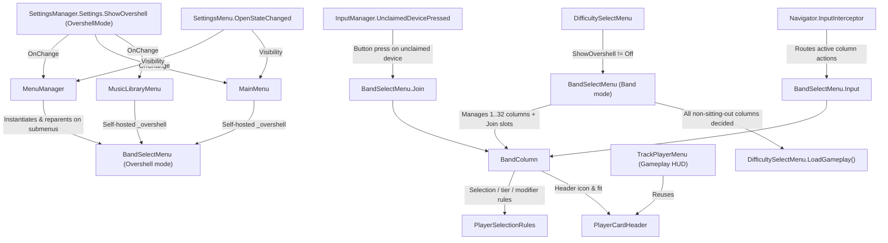

# Overshell & Band Select Architecture

The overshell feature introduces a persistent, per-player card strip (`BandSelectMenu` + `BandColumn`) that lets players join, configure profiles/settings, and ready up across menus or on the difficulty select screen.

---

## 1. Overshell Modes & Hosting

The feature is gated by `OvershellMode` in [SettingsManager.Settings.cs](file:///home/phil/Development/YARG/Assets/Script/Settings/SettingsManager.Settings.cs#L49-L54):

- `Off` (default): Classic [DifficultySelectMenu.cs](file:///home/phil/Development/YARG/Assets/Script/Menu/DifficultySelect/DifficultySelectMenu.cs) runs; `MusicLibraryMenu.NeedsPlayers` shows the no-player warning when `PlayerContainer.Players.Count <= 0`.
- `DifficultySelect`: [DifficultySelectMenu.cs](file:///home/phil/Development/YARG/Assets/Script/Menu/DifficultySelect/DifficultySelectMenu.cs#L136-L147) hides the classic scroll list and opens `BandSelectMenu` in band mode. Earlier menus do not show the overshell, and `MusicLibraryMenu.NeedsPlayers` stays `false` so players can enter a song and join on the band screen.
- `Everywhere`: `MusicLibraryMenu.UseOvershell` is `true`, opening the overshell across menus in addition to band select.

### Two Hosting Strategies

1. **Self-hosted menus** ([MainMenu.cs](file:///home/phil/Development/YARG/Assets/Script/Menu/Main/MainMenu.cs), [MusicLibraryMenu.cs](file:///home/phil/Development/YARG/Assets/Script/Menu/MusicLibrary/MusicLibraryMenu.cs), [DifficultySelectMenu.cs](file:///home/phil/Development/YARG/Assets/Script/Menu/DifficultySelect/DifficultySelectMenu.cs)): Each prefab embeds its own `BandSelectMenu` instance (`_overshell` or `_band`) so its layout integrates directly with menu-specific elements (such as `MusicLibraryMenu`'s sidebar and help-bar spacer).
2. **Dynamic submenu hosting** ([MenuManager.cs](file:///home/phil/Development/YARG/Assets/Script/Menu/MenuManager.cs#L47-L238)): For other menus not in `_selfHostedOvershellMenus` or `_menusWithoutOvershell` (`Credits`, `ProfileList`, `ProfileInfo`, `History`, `CareerList`, `Career`), `MenuManager` lazily instantiates a single `_overshell` from `MainMenu`'s template, calls `DiscardCopiedContent()`, and reparents it onto the active menu.

`MenuManager` and `MainMenu` react to `SettingsManager.Settings.ShowOvershell.OnChange` and `SettingsMenu.OpenStateChanged` rather than polling every frame; `MusicLibraryMenu` also subscribes to `ShowOvershell.OnChange` for open/close transitions and hides `_overshell` whenever `FiltersMenu` or `SettingsMenu` is open.

### Seat Preservation Across Screens

`BandSelectMenu` keeps a static `_seats` map (`Dictionary<YargPlayer, int>`) and calls `PlayerContainer.SetPlayerOrder(...)` ([PlayerContainer.cs](file:///home/phil/Development/YARG/Assets/Script/Player/PlayerContainer.cs#L975-L987)) when columns are reordered or closed, so a player's horizontal card slot persists across `MainMenu`, `MusicLibraryMenu`, submenus, and `DifficultySelectMenu`.

---

## 2. Input Routing & Join Flow

Splitting `BandSelectMenu` into partials separates the four concerns:

- [BandSelectMenu.cs](file:///home/phil/Development/YARG/Assets/Script/Menu/DifficultySelect/BandSelectMenu.cs): Lifecycle (`Open`, `OpenOvershell`, `OpenBand`, `Close`), seat persistence, `OnColumnChanged`, `GetInstrumentBlocker`, and song start readiness.
- [BandSelectMenu.Input.cs](file:///home/phil/Development/YARG/Assets/Script/Menu/DifficultySelect/BandSelectMenu.Input.cs): Per-player and mouse/keyboard input routing.
- [BandSelectMenu.Join.cs](file:///home/phil/Development/YARG/Assets/Script/Menu/DifficultySelect/BandSelectMenu.Join.cs): Join slots, unclaimed device presses, profile attachment/creation, and player add/remove events.
- [BandSelectMenu.Layout.cs](file:///home/phil/Development/YARG/Assets/Script/Menu/DifficultySelect/BandSelectMenu.Layout.cs): Column width fitting, card shift/resize tweens, and `CardSnapshot` transitions.

### How Input Flows

1. **Unclaimed devices**: [InputManager.cs](file:///home/phil/Development/YARG/Assets/Script/Input/InputManager.cs#L34) exposes `UnclaimedDevicePressed`. While `BandSelectMenu` is open and not blocked (`IsJoinBlocked`), `BandSelectMenu.Join` hooks this callback. Pressing a button on an unclaimed non-keyboard/mouse/pen device triggers `Join(device)`, creating a `BandColumn` in `ChooseProfile` state (preselecting the device's saved profile if available).
2. **Overshell vs. Band Mode Navigation**:
   - In **overshell mode**, `Navigator.Instance.InputInterceptor` ([Navigator.cs](file:///home/phil/Development/YARG/Assets/Script/Menu/Navigation/Navigator.cs#L121)) intercepts `NavigationContext` before the underlying menu's `NavigationScheme` sees it. If a player's column is open (or they press an action when an overshell card is engaged), `InterceptOvershellInput` consumes the event; otherwise normal menu navigation proceeds.
   - In **band mode** (`DifficultySelectMenu`), `BandSelectMenu` pushes its own `NavigationScheme` and routes `Up`, `Down`, `Green` (`Confirm`), `Red` (`Back`), and left/right adjustment actions to `ColumnFor(context.Player)`.
3. **Mouse / Click Support**: [JoinSlotClick.cs](file:///home/phil/Development/YARG/Assets/Script/Menu/DifficultySelect/JoinSlotClick.cs) opens a device-less profile picker when a "Press to Join" slot is clicked, and [SettingStepClick.cs](file:///home/phil/Development/YARG/Assets/Script/Menu/DifficultySelect/SettingStepClick.cs) detects left/right clicks on numeric stepper rows (`<  value  >`).

---

## 3. Per-Player Column State Machine (`BandColumn`)

`BandColumn` is organized into four partial files:

- [BandColumn.cs](file:///home/phil/Development/YARG/Assets/Script/Menu/DifficultySelect/BandColumn.cs): `BandColumnState` enum, column lifecycle (`Initialize`, `BeginJoin`, `Open`, `Collapse`, `Back`, `Expand`, `ToggleReady`), and selection/navigation handlers.
- [BandColumn.Menus.cs](file:///home/phil/Development/YARG/Assets/Script/Menu/DifficultySelect/BandColumn.Menus.cs): Row builders for `ChooseProfile`, `Main`, `Difficulty`, `Instrument`, `Adjustments`, `Modifiers`, `Accessibility`, `OpenLane`, `SittingOut`, and `Position`.
- [BandColumn.Settings.cs](file:///home/phil/Development/YARG/Assets/Script/Menu/DifficultySelect/BandColumn.Settings.cs): In-card per-player settings (`Settings` and `SettingOptions` states), `InputMode` switching in overshell mode, and `Confirm()` / `NavigateVertical()` stepper edit mode.
- [BandColumn.Layout.cs](file:///home/phil/Development/YARG/Assets/Script/Menu/DifficultySelect/BandColumn.Layout.cs): Dynamic card width (`SetWidth`, `FitHeader`), row height fitting (`FitRows`), long-label wrapping (`WrapLongRows` / `DifficultyItem.WrapIfLong`), `RectMask2D` scroll fade, row dividers, and collapse/rise DOTween animations.

In band mode, `BandSelectMenu.OnColumnChanged()` checks `IsDecided` across all columns; once at least one player is not sitting out and every column is `IsDecided`, it locks input, slides cards out, and invokes `DifficultySelectMenu.LoadGameplay()`.

---

## 4. Shared Selection Rules & Gameplay HUD Reuse

- [PlayerSelectionRules.cs](file:///home/phil/Development/YARG/Assets/Script/Menu/DifficultySelect/PlayerSelectionRules.cs): Extracts shared instrument/difficulty availability (`SongHasInstrument`, `CollectPossibleDifficulties`), `PickInstrument`, `ShareVocalModifiers`, `GetTierValues`/`GetTierLabel`, and unified `HasNoRangeShifts`/`SetNoRangeShifts` logic so both classic `DifficultySelectMenu` and `BandColumn` obey the same rules. Covered by NUnit tests in [PlayerSelectionRulesTests.cs](file:///home/phil/Development/YARG/Assets/Editor/Tests/PlayerSelectionRulesTests.cs).
- [PlayerCardHeader.cs](file:///home/phil/Development/YARG/Assets/Script/Gameplay/HUD/PlayerCardHeader.cs): Encapsulates Addressables instrument icon loading/release and header text auto-sizing (`Fit`) shared by both `BandColumn` and [TrackPlayerMenu.cs](file:///home/phil/Development/YARG/Assets/Script/Gameplay/HUD/TrackPlayerMenu.cs) using the shared `PlayerCard.prefab`.
